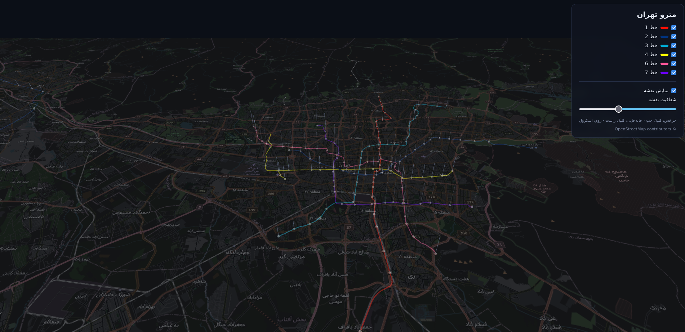
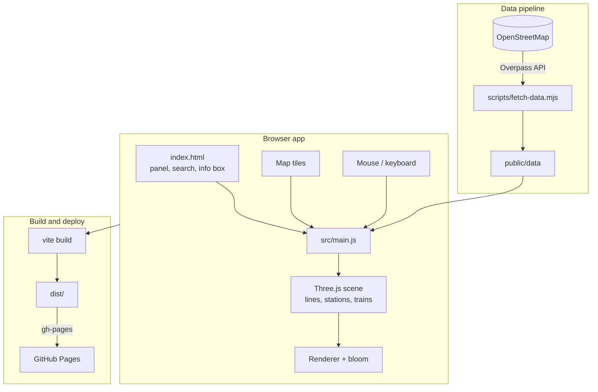

# Tehran Metro 3D

Interactive 3D map of the Tehran Metro network, built with Three.js and OpenStreetMap data.

**Live demo:** https://ali30mhi.github.io/tehran-metro-3d/



## Features

- All metro lines rendered in 3D, each on its own layer (layer spacing is adjustable)
- Animated trains running along the lines
- Station search (press `/` to jump to it)
- Click a station to see its name in Persian and English, plus the lines that serve it
- Hover over a station to see its name
- Dark base map of Tehran that can be hidden or faded
- Adjustable bloom/glow effect
- Auto-rotate and a reset view button

The interface is in Persian (RTL).

## Controls

| Action | Input |
|---|---|
| Rotate | Left click + drag |
| Pan | Right click + drag |
| Zoom | Scroll |
| Station details | Click on a station |
| Search | `/` |
| Close panel | `Esc` |

## Architecture



- `scripts/fetch-data.mjs` queries the Overpass API for Tehran's metro lines and stations and saves the result to `public/data`. It runs locally, so the live site doesn't depend on Overpass being available.
- `src/main.js` loads that data, builds the Three.js scene (one layer per line, station markers, animated trains) and handles mouse interaction, search and the control panel.
- The dark base map is drawn from OSM-based tiles underneath the lines.
- `npm run deploy` builds the project with Vite and publishes `dist/` to the `gh-pages` branch.

## Running locally

```bash
npm install
npm run dev
```

Station and line data is already included in `public/data`. To refresh it from OpenStreetMap:

```bash
npm run fetch-data
```

## Build and deploy

```bash
npm run build    # production build in dist/
npm run deploy   # build and publish to GitHub Pages
```

## Built with

- [Three.js](https://threejs.org/)
- [Vite](https://vitejs.dev/)
- [OpenStreetMap](https://www.openstreetmap.org/) (Overpass API and map tiles)

## Data

Map and metro data © OpenStreetMap contributors, available under the [ODbL](https://opendatacommons.org/licenses/odbl/).
